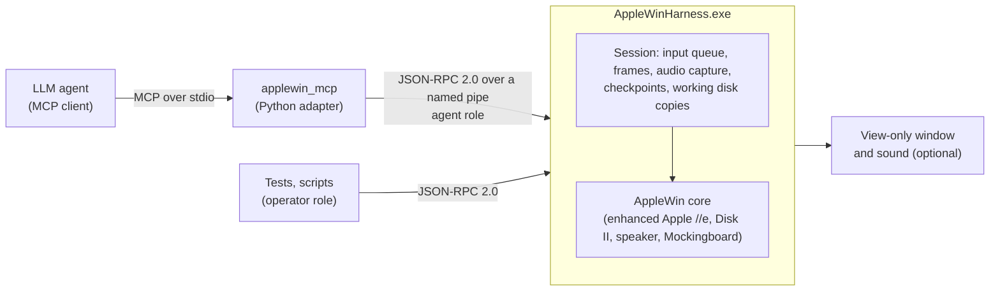

# AppleWin Harness

[](https://github.com/EGrun/applewin-harness/actions/workflows/ci.yml)
[](CHANGELOG.md)
[](#license)
[](#prerequisites)
[](adapter/requirements.txt)
[](adapter/README.md)
[](#limits)

A harness that lets an AI agent use an emulated Apple II through [AppleWin](https://github.com/AppleWin/AppleWin). The agent can only do what a person could: type on the keyboard, move the joystick, look at the screen, and listen. Experiments are safe (disks run on working copies) and reproducible (pause, step, checkpoint).

It has two parts: `AppleWinHarness.exe`, which hosts the AppleWin core and serves it over a local JSON-RPC pipe, and `applewin_mcp`, an MCP server through which an LLM agent (Claude Code, Claude Desktop or any MCP client) uses the machine.

**Status:** alpha, version 0.1.0, Windows only. The harness and the MCP adapter are implemented and tested in CI; the API may still change before 1.0. See [CHANGELOG.md](CHANGELOG.md) and [Limits](#limits).

**New here? Start with the [quick start](docs/QUICKSTART.md).**

## Fair play
The agent gets a player's view and a player's controls, nothing more (decision D4):

- **It can** type and press keys (including timed sequences), move the joystick and press its buttons, look at the screen (whole, a region, zoomed, or as a strip of frames over time), wait for the screen to change, listen to the speaker and Mockingboard, and swap or save floppy disks.
- **It cannot** read or write the Apple's memory or CPU registers, pause the machine in a realtime session, or reach the operator methods (sessions, stepping, state checksums). The MCP adapter only has the agent role.
- **Opt-ins:** `read_screen` (the text on the text screen, for convenience) only exists with `--text-screen`. Checkpoints (save and restore, like an emulator's save states) only exist in stepped sessions, never with `--realtime`.

## How it fits together


## Documentation
| Document | What it covers |
|---|---|
| [docs/QUICKSTART.md](docs/QUICKSTART.md) | Install, connect an MCP client, run a first task, troubleshooting |
| [adapter/README.md](adapter/README.md) | The MCP server: every tool, launch flags, behaviour notes |
| [adapter/examples/basic_count.md](adapter/examples/basic_count.md) | An example task with its success check and client configs |
| [docs/api_spec.md](docs/api_spec.md) | The JSON-RPC API on the named pipe |
| [docs/decisions.md](docs/decisions.md) | Design decisions (D1 to D14) and their status |
| [project.md](project.md) | Goal, architecture, milestone history, risks |
| [CONTRIBUTING.md](CONTRIBUTING.md) | Building, testing and licensing of contributions |
| [SECURITY.md](SECURITY.md) | Reporting vulnerabilities, and the threat model |
| [CHANGELOG.md](CHANGELOG.md) | Versions |
| [NOTICE.txt](NOTICE.txt), [THIRD-PARTY-NOTICES.txt](THIRD-PARTY-NOTICES.txt) | Licensing, the source offer, ROMs and third-party components |

## Prerequisites
- Windows 10/11 x64
- Visual Studio 2022 with the "Desktop development with C++" workload (v143 toolset)

## Getting the source
[AppleWin](https://github.com/AppleWin/AppleWin) is included as a pinned git submodule at `external/AppleWin` (decision D7). Clone with:

```
git clone --recurse-submodules https://github.com/EGrun/applewin-harness.git
```

If you already cloned without it, run:

```
git submodule update --init
```

## Install from the release zip
The release zip `applewin-harness-<version>-win64.zip` holds the harness exe and the MCP adapter, so no build is needed. You need Windows 10/11 x64 and Python 3.12+.

1. Unzip it. The folder you get is `<BUNDLE>` below.
2. Install the adapter's one dependency: `pip install -r <BUNDLE>\adapter\requirements.txt`.
3. Get a DOS 3.3 System Master disk image. The zip contains no disk images. Download `DOS 3.3 System Master - 680-0210-A.dsk` from the AppleWin repository's [`bin/` directory](https://github.com/AppleWin/AppleWin/tree/master/bin) and note its path (`<DISK>` below). The harness works on a copy, so the original is never changed.
4. Add the server to your MCP client. For Claude Code, put this in `.mcp.json`:

```json
{
  "mcpServers": {
    "applewin": {
      "type": "stdio",
      "command": "<PYTHON>",
      "args": [
        "-m", "applewin_mcp",
        "--exe", "<BUNDLE>\\AppleWinHarness.exe",
        "--disk", "<DISK>",
        "--text-screen"
      ],
      "env": { "PYTHONPATH": "<BUNDLE>\\adapter" }
    }
  }
}
```

Replace `<PYTHON>`, `<BUNDLE>` and `<DISK>` with absolute paths (backslashes doubled in JSON). [adapter/examples/basic_count.md](adapter/examples/basic_count.md) has the Claude Desktop form and an example task. `AppleWinHarness.exe --version` prints the version. The zip is built by `tools\make_release.ps1` after a Release build, and `tools\make_source_archive.ps1` builds the matching source archive (this repository plus AppleWin); CI builds it, runs the adapter end-to-end test from the extracted zip, and uploads it as an artifact.

## Build
Open `AppleWinHarness.sln` in Visual Studio, or build from a Developer Command Prompt:

```
msbuild AppleWinHarness.sln -p:Configuration=Debug -p:Platform=x64
```

The executable is written to `bin\x64\<Configuration>\AppleWinHarness.exe`.

## Run
```
AppleWinHarness.exe [--headless] [--realtime] [--disk1 <image>] [--png <path>] [step ...]
step: --frames <n> | --type <text>
```
- Steps run in command-line order. `--frames n` runs `n` frames. `--type text` types the text on the emulated keyboard. Both run at authentic speed, paced to real time, with `--realtime`, and as fast as possible otherwise.
- `--type` escapes: `\r` and `\n` both mean Return, and `\\` means a backslash. Any other backslash sequence, an empty text, or a character outside `0x20`-`0x7E` is a usage error.
- `--frames` takes 1-9 decimal digits.
- `--disk1` boots from a working copy of the image in `%TEMP%\applewin-harness\<pid>\`. The original is never written to, and the copy is deleted on exit.
- After the last step the harness writes the PNG if `--png` was given, prints `sha256 <hash>` of the frame, and, if sound is active, prints `audio underruns <n>`.
- With no steps, windowed mode runs until you close the window and exits with 0. Headless mode with no steps is a usage error.
- `--headless`, `--realtime`, `--disk1` and `--png` may each appear once. Closing the window during a run prints `error: window closed` and exits with 1.
- Exit codes: 0 success, 2 bad arguments (usage on stderr), 1 any other failure.

The default display mode is windowed: a view-only window shows the live Apple screen and plays its sound (keys and mouse clicks in the window do nothing). Sound plays only during realtime runs (`--realtime`, or windowed with no steps); stepped runs without `--realtime` are muted. `--headless` opens no window and no audio device, for CI and batch runs (decision D8).

Speed: `set_speed` and `get_speed` follow AppleWin's own controls (decision D11). With "Enhance disk access speed" on (the default), an empty Disk II drive counts as a running motor, so a realtime or windowed run with no disk spins at full speed; turn `enhance_disk_speed` off for authentic pacing. The window plays sound only at authentic speed, not at full speed; agent audio capture is unaffected (decision D14).

Agent audio: through `--serve`, an agent can hear the Apple with `get_audio` and `subscribe_audio` in every mode, headless and stepped included (decisions D12, D14). In windowed mode the sound you hear lags the window by about 200 to 300 ms.

Examples:
```
:: windowed (default): live view-only window and sound until you close it
AppleWinHarness.exe

:: headless golden run: boot DOS 3.3 (720 frames), type PRINT 2+2, save the screen
AppleWinHarness.exe --headless --disk1 "external\AppleWin\bin\DOS 3.3 System Master - 680-0210-A.dsk" --frames 720 --type "PRINT 2+2\r" --frames 60 --png out.png

:: windowed, real time: the bell
AppleWinHarness.exe --realtime --disk1 "external\AppleWin\bin\DOS 3.3 System Master - 680-0210-A.dsk" --frames 720 --type "PRINT CHR$(7)\r" --frames 120
```

## Serve (JSON-RPC over a named pipe)
```
AppleWinHarness.exe --serve [--headless]
```
- Prints one JSON line on stdout, `{"pipe":"\\\\.\\pipe\\applewin-harness-<id>","agent_token":"...","operator_token":"...","pid":<n>}`, and then serves. `--serve` can't be combined with `--realtime`, `--disk1`, `--png` or any step.
- One session per process. The process exits 0 after `close_session`, or when the window is closed.
- The protocol is in [docs/api_spec.md](docs/api_spec.md).

A Python client using only the standard library lives in `tests/python/harness_client.py`:

```python
import sys
sys.path.insert(0, "tests/python")
from harness_client import Harness

h = Harness.launch(headless=True)
op = h.connect("operator")
op.call("create_session", disks=[{"slot": 6, "drive": 1, "path": r"C:\disks\dos33.dsk"}], run_mode="stepped")
op.call("step_frames", frames=720)
agent = h.connect("agent")
agent.call("type_text", text="PRINT 2+2\n", inter_key_delay_ms=0)
op.call("step_frames", frames=60)
frame = agent.call("get_frame", format="PNG")   # frame["data"] is base64
op.call("close_session")
h.close()
```

Checkpoints (decision D5): `checkpoint` saves the machine and the working disks together, and `restore_checkpoint` brings both back. Restoring the same checkpoint and running the same script gives the same state checksum, frames and audio.

Continuing a stepped session that has booted (as above, before `close_session`):

```python
cp = op.call("checkpoint", name="booted")["checkpoint_id"]      # "cp-1"

def run_script():
    op.call("restore_checkpoint", checkpoint_id=cp)
    agent.call("type_text", text="CATALOG\n", inter_key_delay_ms=0)
    op.call("step_cycles", cycles=500000)
    op.call("step_frames", frames=60)
    return op.call("get_state_checksum")["sha256"]

assert run_script() == run_script()
op.call("export_disk", slot=6, drive=1, dest_path=r"C:\out\dos33-result.dsk")   # keep the working disk
```

Run the Python tests (build first; `HARNESS_EXE` defaults to `bin\x64\Debug\AppleWinHarness.exe`):
```
set HARNESS_EXE=%CD%\bin\x64\Release\AppleWinHarness.exe
python -m unittest discover -s tests/python -v
```

## MCP agent adapter
`adapter/applewin_mcp` is an MCP server (stdio) that lets an LLM agent use the emulated Apple II. See [adapter/README.md](adapter/README.md) and the example task [adapter/examples/basic_count.md](adapter/examples/basic_count.md).

```
pip install -r adapter/requirements.txt
python -m unittest discover -s tests/adapter -v
```
Run the adapter tests from the repository root, with `HARNESS_EXE` set as for the Python pipe tests.

## Tests
```
REM everything
bin\x64\Debug\HarnessTests.exe
REM what CI runs
bin\x64\Debug\HarnessTests.exe -tse=windowed,audio
```
Suites with special needs are tagged: `realtime` (paced runs), `windowed` (needs a desktop session) and `audio` (needs an audio device; includes a 60-second underrun test, about 70 s). CI (`.github/workflows/ci.yml`, windows-2022) builds Debug and Release x64, runs `HarnessTests.exe -tse=windowed,audio`, then the Python pipe tests, and then the adapter tests.

## Limits
- **Windows 10/11 x64 only.** The AppleWin core is a Win32 program.
- **Alpha.** The pipe protocol (`protocol_version` 0.3) and the MCP tools may change before 1.0.
- **One machine per process.** Each harness process runs one session: an enhanced Apple //e with a Disk II controller in slot 6 (two drives) and joystick 0. Run more processes for more machines.
- **Realtime sessions** run while the agent thinks, so its think time passes in the game; send timed manoeuvres with `press_keys`. `wait_until_change` can miss a change that lasts a single frame. There are no checkpoints.
- **Stepped sessions** run a long `wait_until_change` frame by frame, so long timeouts take real time.
- **Local only.** No network access, no session record/replay, no sector-level disk editing.
- **Sound in the window** plays only at authentic speed; the agent's audio capture works at every speed.

## Credits
- [AppleWin](https://github.com/AppleWin/AppleWin), the emulator this harness hosts, by Michael O'Brien, Oliver Schmidt, Tom Charlesworth, Michael Pohoreski and the AppleWin contributors.
- [zlib](https://zlib.net/) and minizip, [libyaml](https://github.com/yaml/libyaml), [nlohmann/json](https://github.com/nlohmann/json), [doctest](https://github.com/doctest/doctest), and the [MCP Python SDK](https://github.com/modelcontextprotocol/python-sdk).

## License
The license is split (decision D6):

- **MIT:** what this project wrote (`src/`, `tests/`, `adapter/`, `tools/`, `docs/`). See [LICENSE](LICENSE). Each source file has an `SPDX-License-Identifier` header. Three files contain short pieces copied from AppleWin and say so in their header (`GPL-2.0-or-later`, or `MIT AND GPL-2.0-or-later`): `src/host/applewin_host.cpp`, `src/host/virtual_sound.cpp` and `src/host/emulator.cpp`.
- **GPL-2.0-or-later:** the binaries `AppleWinHarness.exe` and `HarnessTests.exe`, because they link AppleWin, which is GPL-2.0-or-later. See [LICENSE-GPL-2.0.txt](LICENSE-GPL-2.0.txt). [NOTICE.txt](NOTICE.txt) gives the source offer.
- **Third-party components** (AppleWin, zlib, minizip, libyaml, nlohmann/json, and the `mcp` package the adapter installs) keep their own licenses. See [THIRD-PARTY-NOTICES.txt](THIRD-PARTY-NOTICES.txt).

**ROMs and disk images are not under these licenses.** `AppleWinHarness.exe` contains the Apple II ROM images that AppleWin carries (copyright Apple Inc. and others, no license that we know of; see "ROM images" in [NOTICE.txt](NOTICE.txt)). No disk images are among this repository's own files or the release zip, but the `external/AppleWin` submodule includes the ones AppleWin keeps in its `bin/` directory (such as the DOS 3.3 System Master, Apple Inc.'s copyright), and the tests use them. You can also get the DOS 3.3 System Master from the AppleWin repository's [`bin/` directory](https://github.com/AppleWin/AppleWin/tree/master/bin).

Apple, Apple II and Apple //e are trademarks of Apple Inc. This project is not affiliated with or endorsed by Apple Inc. or the AppleWin project.
